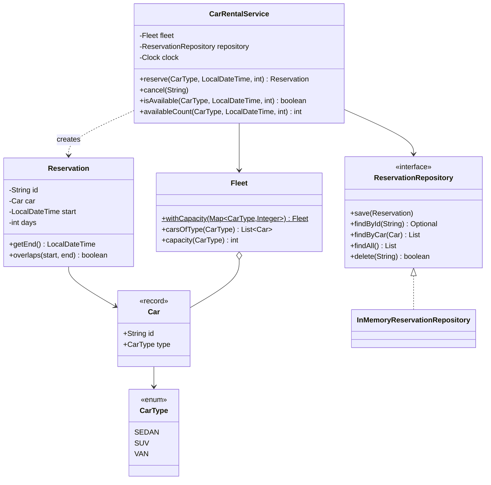

# Car Rental System

A simulated car rental reservation system written in Java 17 using object-oriented design, with JUnit 5 unit tests that prove each requirement.

## Requirements covered

| # | Requirement | Where it's proven |
|---|---|---|
| 1 | Reserve a car of a given type at a desired date and time for a given number of days | `CarRentalServiceTest.Reserving` |
| 2 | Three car types: sedan, SUV, van | `CarRentalServiceTest.CarTypes` |
| 3 | The number of cars of each type is limited | `CarRentalServiceTest.LimitedCapacity`, `FleetTest` |
| 4 | Unit tests prove the system works | 42 tests across `src/test` |

Also covered: cancellation, input validation, and concurrent requests that must not overbook.

## How to run

Requires JDK 17+ and Maven 3.8+.

```bash
mvn test                      # run all unit tests
mvn -q compile exec:java      # run the console demo
```

## Design



### Classes and their single responsibility

| Class | Responsibility |
|---|---|
| `CarType` | The three kinds of car. An enum makes an invalid type impossible to express. |
| `Car` | One physical car (immutable record). |
| `Reservation` | A booking of one car for a time window; knows its end time and whether it overlaps another window. |
| `Fleet` | The fixed, immutable set of cars per type. This is where the capacity limit lives. |
| `ReservationRepository` | Storage abstraction, so the in-memory store can be replaced by a database without touching the service. |
| `CarRentalService` | Business rules: validation, availability, allocation, cancellation. |
| Exceptions | `NoCarAvailableException`, `InvalidReservationException`, `ReservationNotFoundException` give callers clear, specific failures. |

### Key decisions

**Time windows are half-open, `[start, end)`.** A rental of N days ends at `start + N days`. Two windows overlap only if each starts before the other ends:

```java
start.isBefore(otherEnd) && otherStart.isBefore(end)
```

So a car returned at 10:00 can be picked up again at 10:00.

**Each reservation is assigned a specific car (first-fit).** The service looks through the cars of the requested type and books the first one with no overlapping reservation. This is simple, mirrors the real world (a customer gets a particular car), and makes the capacity limit easy to reason about.

*Trade-off:* first-fit can occasionally reject a request that would fit if earlier bookings were moved to different cars. For example, with 2 SUVs, booking Jan 1–3 (gets SUV-1), then Jan 2–4 (SUV-2), then Jan 5–7 (SUV-1) means a request for Jan 3–6 is rejected: SUV-1 is busy from Jan 5 and SUV-2 until Jan 4. Yet at no moment are both SUVs in use, and moving the Jan 5–7 booking to SUV-2 would free SUV-1. The alternative is to track only counts per type and accept a request whenever the number of overlapping bookings never reaches capacity at any moment (a sweep over start and end points). That never rejects a feasible request, but cars are assigned only at pick-up time.

**The clock is injected.** `CarRentalService` takes a `java.time.Clock`, so tests use a fixed "now" and the "no bookings in the past" rule is tested reliably.

**Thread safety.** Public service methods are `synchronized`, so the check-then-book sequence is atomic and two simultaneous requests can never take the same car. A test fires 20 concurrent requests at a fleet of 2 sedans and checks that exactly 2 succeed. With a database, the same guarantee would come from a transaction with row locks or a unique constraint.

**Dependency inversion.** The service depends on the `ReservationRepository` interface, not on the in-memory implementation.

### Assumptions

- A day is 24 hours from the pick-up time.
- Number of days must be at least 1.
- Pick-up time must not be in the past.
- The fleet size is fixed when the system is created.
- Sample Main.java books the car 10 minutes after the actual booking time. 10 minute delay added for the finishing the rental process.
- Out of scope: pricing, customers, payments, persistence, multiple branches, and a UI or API.

### Complexity

Checking availability is O(r) where r is the number of reservations for that car type. For a real system, each car's reservations could be kept sorted by start time (for example in a `TreeMap`) so an overlap check becomes O(log r).

## Possible extensions

- Pricing per car type, using the Strategy pattern
- Customers and reservation history
- Multiple branches with their own fleets
- Database persistence through a new `ReservationRepository` implementation
- A REST API on top of `CarRentalService`
- Modifying a reservation (change dates or type)

## Project structure

```
src/main/java/com/example/carrental/
├── Main.java                         console demo
├── model/        CarType, Car, Reservation
├── fleet/        Fleet
├── repository/   ReservationRepository, InMemoryReservationRepository
├── service/      CarRentalService
└── exception/    NoCarAvailableException, InvalidReservationException, ReservationNotFoundException
src/test/java/com/example/carrental/
├── model/ReservationTest.java        overlap and end-time rules
├── fleet/FleetTest.java              capacity per type
└── service/CarRentalServiceTest.java requirements, validation, cancellation, concurrency
```
